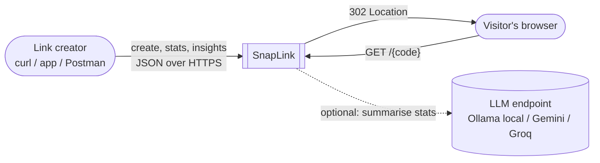
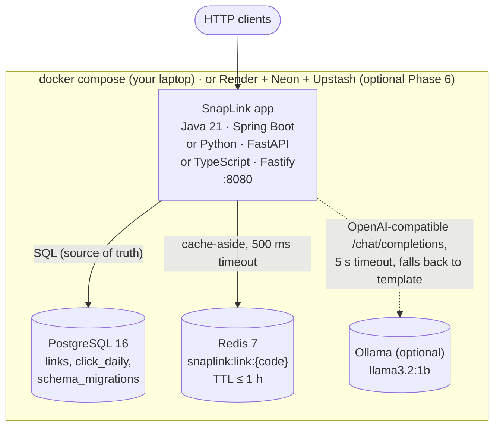
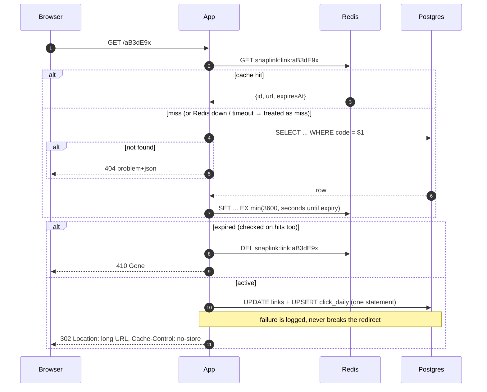
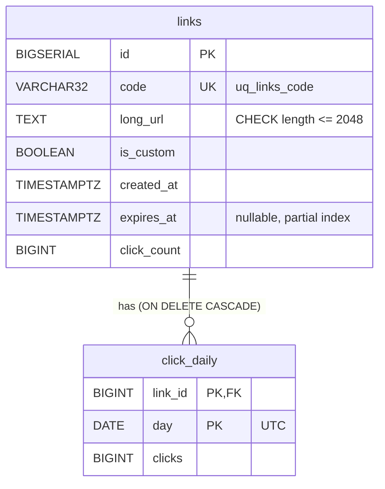

# SnapLink architecture

> Reference solution for Phase 2 (tag `phase-2-end`). Diagrams are [Mermaid](https://mermaid.js.org/);
> GitHub renders them, and so do most IDEs and the aicancode.org lesson viewer.

## 1. Context diagram

SnapLink **never fetches the target URL** (no SSRF surface) and stores no personal data (NFR-3, NFR-4).

## 2. Container diagram

* **Hot path:** `GET /{code}` → Redis → (miss) Postgres → one SQL statement to count the click.
* **Every track is a drop-in replacement** for the others: same port, env vars, schema and contract.

## 3. Redirect sequence (cache-aside)

## 4. Data model

* `uq_links_code` is the **source of truth for uniqueness**: we insert and retry on a unique violation
  instead of "check, then insert" (which races).
* `click_daily` is pre-aggregated (one row per link per day) so stats are a tiny range scan, and no
  per-visitor data is stored (NFR-4).
* Schema: [`db/migrations/V1__init.sql`](db/migrations/V1__init.sql).

## 5. Key decisions
* [ADR-0001](adr/0001-short-code-generation.md) — random Base62 codes + retry on collision
* [ADR-0002](adr/0002-302-redirects.md) — `302` + `no-store` instead of `301`
* [ADR-0003](adr/0003-click-counting.md) — synchronous single-statement click counting in Postgres
* Shared contract: [`openapi.yaml`](openapi.yaml) (problem+json errors, ISO-8601 UTC timestamps with milliseconds)
